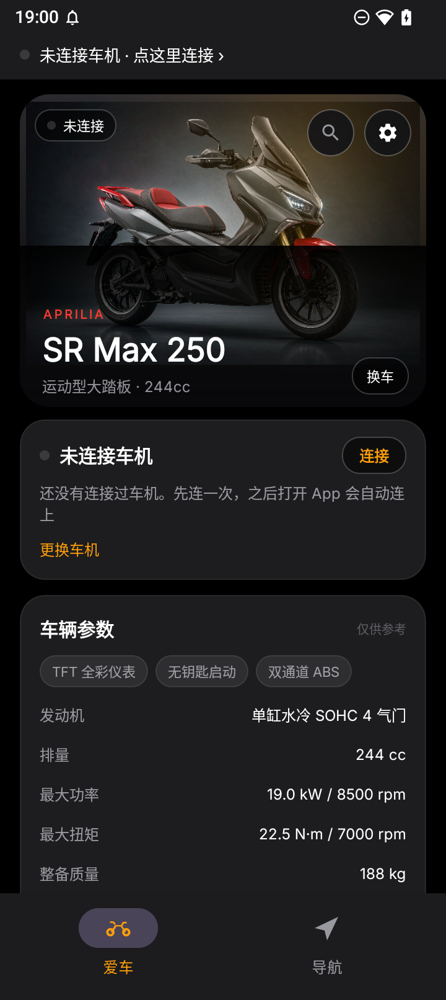
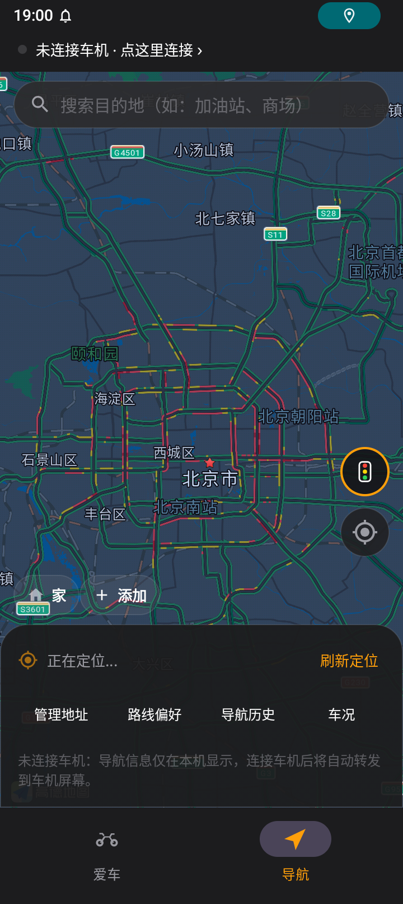
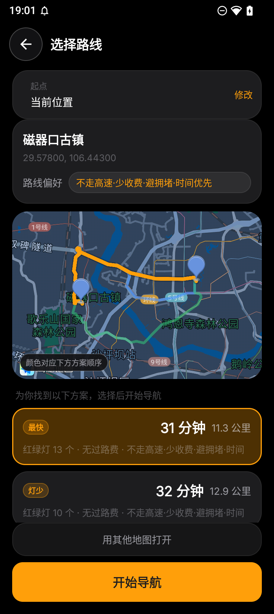
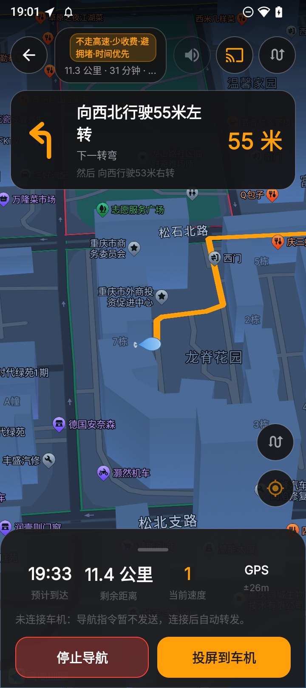
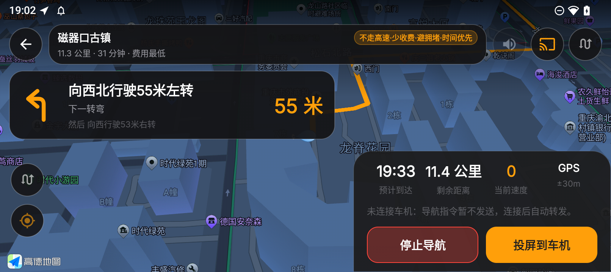
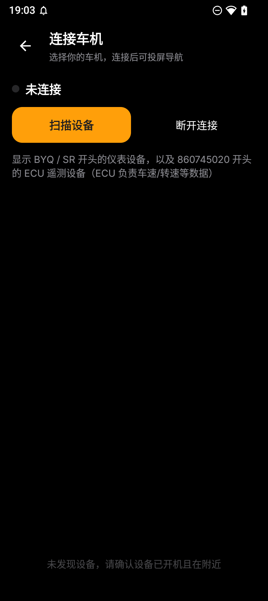

# 机车车机助手 · MotoHUD Core（核心双功能版）

面向**支持 BLE 车机互联的摩托车仪表**的 Android 工具：把手机的高德导航投到车机屏幕上。

> 本项目独立开发，与任何整车厂商、车机厂商均无从属关系，也不包含其任何代码、图片或资源。

---

## 这是哪个版本

仓库 `motohud-core` 是**核心双功能版**：

- **爱车**：车型大图 + 实时连接状态 + 设备信息 + 数据能力说明；内置车型库，连接后按车机名自动匹配，也能手动「换车」。
- **导航**：高德地图展示 + 目的地搜索（POI 输入提示）+ **先选路线再导航** + 转向引导（TTS 播报）+ 横竖屏自适应 + 投屏车机 + 导航历史与轨迹。

之所以只保留这两块，是因为**实测原厂车机仅有通道 A（投屏导航）可用**——仪表/体检/故障码等遥测通道在 BLE 侧**没有数据上行**（上行帧数为 0，原厂体检走 HTTP 且接口已死）。把读不到数据的空壳页塞进来只会误导用户，所以全功能线（车况/体检/指令/通知转发/本地检索 + 横屏 HUD）被冻结归档到 [`motohud-bridge`](https://github.com/mmaotv/motohud-bridge)（分支 `archive/full-2.2.7`，标签 `v2.2.7-archive`）。

**想看「功能全」的旧版**或需要车况/指令能力的，请去 archive 仓库；新功能只进 `motohud-core`。

---

## 功能

| 模块 | 说明 |
| --- | --- |
| **爱车** | 首页：车型大图 + 场景光晕、实时连接状态、已连接设备信息（设备名 / 协议 / BLE 状态）、数据能力说明（✓ 投屏导航 · ✓ 自动回连 · ✕ 仪表遥测 · ✕ OBD，并注明车机无遥测上行）；内置 8 款比亚乔集团车型，连接后按蓝牙名自动匹配，也可手动「换车」 |
| **连接** | 扫描并连接车机（自动过滤 `BYQ*` / `SR*` 与 `860745020*` 三类设备名），兼容双协议栈（FastBLE 服务 `00003719` + legacy GATT `0000ff33`），**掉线自动重连**；入口在爱车页的「去连接」 |
| **导航** | 高德地图展示 + 目的地搜索（POI 输入提示）+ **最近 5 条搜索历史** + 起点设置（可选，用于非实时定位场景）+ **先选路线再导航** + 转向引导（TTS 播报）+ 3D 跟随；常用地址（家/公司/自定义）一键进入选路线流程 |
| **路线偏好** | 高德智能推荐 / 高速优先 / 不走高速 / 躲避拥堵 / 少收费 / 路况优先 / 时间优先，除「智能推荐」外均可多选；偏好同时作用于方案生成与实际算路，导航页与路线页都有实时徽章 |
| **引导页** | 转向横幅、全程剩余、预计到达、实时速度、定位质量、语音开关、全览/回中；与车机投屏**共用同一个导航引擎**，切来切去不中断；**跟随系统自动横竖屏** |
| **偏航重算** | 行驶中持续偏离路线（>90m 且定位精度尚可）超过数秒，自动判定「开错路」并重新规划路线（无需手动操作） |
| **更优换线** | 每隔几分钟用当前位置重新算路并对比：若发现明显更快的路线，或前方出现明显拥堵且「避拥堵」方案更畅通，顶部提示「采用 / 忽略」 |
| **投屏** | 导航中「投屏到车机」开关：开启即把转向图标与剩余距离实时写入车机（`REM/NEXT/NAVI` 或 `NA/RE/NE`），到达发 `FINISH`，退出发 `NO`；可开**息屏导航**（前台服务 + WakeLock，熄屏后引导与转发不中断） |
| **关于** | 本机版本号、连接仓库 Release 自动检查更新与更新日志（可下载 APK 直接安装）、导航历史入口 |

底部主导航只有 2 个页签：**爱车 / 导航**，顶部常驻连接状态条。
未连接时状态条显示「未连接车机 · 点击前往连接」并提供唯一的「去连接」入口。

首次启动提供 4 步新手引导（欢迎 → 隐私政策 → 如何连接车机 → 如何开始导航），之后可在「设置 → 重新查看新手引导」再次查看。

---

## 界面截图

| 爱车 | 导航首页 | 路线选择 |
| --- | --- | --- |
|  |  |  |

| 引导（竖屏） | 引导（横屏） | 连接 / 扫描 |
| --- | --- | --- |
|  |  |  |

---

## 适用设备

- 具备 BLE 仪表 / 车机互联能力的摩托车，实测为**比亚乔（Piaggio）**系列随车 BLE 仪表；
- 连接页按设备名前缀自动识别：`BYQ*`、`SR*`，以及 MAC 前缀 `860745020*`；
- 其他品牌只要符合文末「协议要点」，改动 `ScanFragment` 的过滤规则即可适配。

---

## 车型库

内置 8 款车型，爱车页按车型展示大图与整车参数（排量、功率、扭矩、整备质量、座高、油箱、轮胎等）：

| 品牌 | 车型 |
| --- | --- |
| **APRILIA**（阿普利亚） | SR Max 250、SR Max 300、GPR 150、GPR 250 |
| **VESPA**（威斯帕） | Primavera 150、GTS 300 |
| **PIAGGIO**（比亚乔） | Beverly 300、Medley 150 |

- 连接车机后按蓝牙名自动匹配一次（`SR*` → SR Max、`GPR*` → GPR、`BYQ*` → Beverly 等），猜错可在「爱车 → 换车」里改；
- 车型数据在 `app/src/main/java/com/motohud/ble/data/bike/BikeCatalog.kt`，新增车型只要加一条记录；
- 车型图放在 `app/src/main/assets/bikes/`，**同名替换即可生效**：

| 文件 | 对应车型 |
| --- | --- |
| `sr_max.png` | SR Max 250 / 300 |
| `gpr.png` | GPR 150 / 250 |
| `vespa.png` | Primavera 150 / GTS 300 |
| `beverly.png` | Beverly 300 / Medley 150 |

---

## 快速开始

### 1. 编译

```bash
# 需要 JDK 17、Python 3 与 Android SDK（compileSdk 36）

# ① 准备高德 SDK：下载 → 合并去重 → 解出 so 与 assets（SDK 不进仓库）
python tools/prepare_amap_sdk.py

# ② 编译
./gradlew assembleDebug
# 产物：app/build/outputs/apk/debug/app-debug.apk
```

首次编译前在项目根目录创建 `local.properties`：

```properties
sdk.dir=/path/to/Android/Sdk
amap.apiKey=你的高德Key      # 可选，也可在应用内填写
```

> 高德官方只把类 jar 发布到 Maven，`.so` 与 `assets` 都打包在 jar 内部，
> Gradle 不会自动处理，所以需要第 ① 步。SDK 版权归高德所有，仓库不分发。

### 2. 地图与搜索的 Key

地图、目的地搜索、路线规划由**高德开放平台** SDK 提供。

**Key 必须自己申请，无法复用别人的（包括旧版 App 的）。** 原因不在 SDK，而在高德服务端：
Android Key 与「包名 + 签名证书 SHA1」绑定，请求时 SDK 会把两者一起发给高德校验，
包名或签名对不上就返回 `INVALID_USER_KEY (10001)`。改包名、换签名之后，任何旧 Key 都会立刻失效。

申请免费、几分钟即可：

1. 打开 <https://lbs.amap.com>，注册个人开发者 → 创建应用 → 添加 Key → 选择 **Android 平台**；
2. 填包名 `com.motohud.ble` 与签名 SHA1 —— **应用内「设置 → 高德地图 Key」已经把你当前的包名和 SHA1 算好并支持一键复制**；
3. 到「服务管理」开通 **地图 SDK**、**搜索**、**定位** 三项；
4. 把 Key 粘贴回应用内的输入框，保存后立即生效。

未配置 Key 时：地图区域隐藏，POI 搜索不可用，但**蓝牙投屏导航仍可用**
（引擎按直线推算演示转向与剩余距离，方便验证车机链路）。

### 3. 使用

1. 摩托通电，车机进入可配对状态；
2. 「爱车」页 → 「去连接」→ 扫描设备 → 点击目标设备；断线后会在回到范围内时**自动回连**；
3. 顶部状态条变绿即连接成功，爱车页显示设备信息与连接状态；
4. 「导航」页搜索目的地（或点击「家 / 公司」常用地址）→ 进入**选择路线**页 → 选方案 → 「开始导航」；
5. 引导页：转向横幅 + 剩余 / ETA / 实时速度。点「投屏到车机」开关即把转向与剩余发到车机（手机导航继续在后台跑），再点一次关闭；
6. **开错路会自动重新规划**；行驶中若发现更快 / 更畅通的路线，顶栏会提示「采用 / 忽略」，点了立即换线；
7. 「投屏」开关里可开「息屏导航」，熄屏后引导与转发继续工作；
8. 「爱车 → 设置 → 关于」可查看版本、检查更新、查看导航历史。

---

## 摩托车导航与路线偏好

**高德没有免费的摩托车算路。** 两条路都走不通：

- 导航 SDK（AMapNavi）的 `PathPlanningStrategy.MOTOR_MULTIPLE_*` 属于**收费接口**，
  要单独提交商务工单申请授权，未授权时算路直接失败；
- 本项目用的搜索 SDK（免费）`RouteSearch` 只有驾车 / 步行 / 骑行 / 公交，**没有任何摩托车策略**。

所以本 App 用「摩托车可达路网近似」：走驾车算路，但把「不走高速 / 不走快速路 / 躲避拥堵 / 少收费」
这些摩托车最关心的约束做成**可选、可多选**的路线偏好，由用户自己勾，而不是写死。

### 路线偏好

「路线偏好」对话框（导航页与路线选择页都能进）提供 7 项：

| 选项 | 说明 |
| --- | --- |
| 高德智能推荐 | 高德多策略综合推荐（默认）。勾选时其余项置灰禁用 |
| 高速优先 | 允许走高速 |
| 不走高速 | 排除高速/快速路（与「高速优先」互斥） |
| 躲避拥堵 | 排除拥堵路段 |
| 少收费 | 优先避开收费 |
| 路况优先 | 以实时路况为准 |
| 时间优先 | 以最快到达为准 |

「高德智能推荐」之外均可多选。多个条件会按
`不走高速 > 少收费 > 躲避拥堵 > 高速优先 > 时间优先 > 路况优先`
的优先级合并到高德的 `DRIVING_MULTI_CHOICE_*` 组合常量上（高德策略是单个 int，不是位掩码，
所以只能合并成一个最接近的组合）。当前生效的偏好在导航页和路线选择页都有徽章实时显示。

### 先选路线再导航

1. 选中目的地（搜索结果 / 常用地址）→ 进入**选择路线**页；
2. 高德一次返回 2~3 套方案，按耗时排序，每套标出时间、距离、红绿灯数、过路费，并在地图上用不同颜色画出各方案轨迹，点选高亮；
3. 选中一套 → 点「开始导航」进入引导页；改动偏好会立即按新策略重算；
4. 路线页还有一个「用其他地图打开」，可把该目的地交给高德 / 百度 / 腾讯 / 系统地图继续导航。

方案几何点动辄几千个，塞不进 Intent（1MB 限制会抛 `TransactionTooLargeException`），
所以选定方案通过进程内 `navi/RouteHandoff.kt` 交接，并校验目的地一致后才取出。

国内禁摩/限行主要针对快速路、高架、隧道与部分主干道，勾上「不走高速」能绕开大部分硬禁区，
这也是骑行类 App 的通行做法。导航页常驻提示「摩托车能否上路以当地法规与现场禁摩标志为准」。
将来若拿到导航 SDK 商务授权，只需在 `NaviPrefs` 里把摩托车映射到 `MOTOR_MULTIPLE_DEFAULT`，上层无需改动。

---

## 偏航重算与更优换线

这是核心双功能版重点打磨的导航体验，也是和「只会一条道走到黑」的旧式投屏最大的区别：

- **偏航重算**：引擎每帧把 GPS 位置投影到路线，当持续偏离路线超过约 90m（且定位精度尚可）达数秒，即判定「开错路」，自动用当前位置重新规划并平滑接管，无需手动操作。吸附逻辑只用于把车标画在路上，不会掩盖真正的偏离。
- **更优换线**：每隔几分钟用当前位置重新算路并与当前路线对比。若发现明显更快（省时 ≥5 分钟）的路线，或前方出现明显拥堵（TMC 拥堵分段 ≥800m）且「避拥堵」方案明显更畅通，顶栏弹出非阻塞提示「采用 / 忽略」，点了立即换线；忽略则本次导航不再打扰。

> 拥堵数据来自高德搜索 SDK 的 `DriveStep.TMCs()` 实时分段（畅通 / 缓行 / 拥堵 / 严重拥堵）。
> 真正「基于实时路况的秒级动态重算」需要高德**导航 SDK**（Navigation SDK）的实时交通能力，
> 当前架构仅用搜索 SDK，因此换线以「周期性重算 + 拥堵分段对比」实现，属于可用的近似方案；
> 接入导航 SDK 是后续可升级项。

---

## 定位精度（为什么以前会「漂移」）

「导航一直漂」不是单个 bug，是四层问题叠加，现在逐层处理：

| 层 | 问题 | 处理 |
| --- | --- | --- |
| 坐标系 | 系统 `LocationManager` 给 **WGS84**，地图与路线是 **GCJ02**，国内恒定差 300~700m | 所有系统定位帧统一 `wgs84ToGCJ()` 纠偏后再进引擎 |
| 定位源 | 系统 GPS 精度差、无速度航向；网络定位误差可达几百米 | 主用高德连续定位（GCJ02 + 多源融合 + 传感器辅助），**同时保留系统定位兜底**（高德 5s 无输出时接管） |
| **缓存首帧** | 高德默认会把上一次的定位结果当第一帧回调。人在重庆、App 几小时前在北京开过，这一帧就把车标甩到北京，看起来像"定位漂移" | 单次定位显式关闭缓存（`isLocationCacheEnable=false`），并要求"最新"结果；系统定位兜底也丢弃 **90 秒以上**的旧缓存 |
| 错点 | 冷启动第一帧常是网络/基站定位，一帧就能把车标甩到别的城市（地图看起来「白屏、路线不见了」） | 起点先 `seed()` 给滤波器打底；按 216km/h 上限做**物理不可能位移**判定，只有连续 3 帧且精度 ≤20m 才允许重新定上位 |
| 抖动/滞后 | 静止时坐标来回跳；行驶中强平滑导致越拖越远 | 速度自适应指数平滑（静止 α=0.12，跳变 α=0.85）；提供者不给速度时用位移/时间估算 |
| 画法 | 算路会把起点吸到最近道路，GPS 原始点常在路侧几十米，车标看着「不在路上」 | 车标按偏离距离分级吸附到路线（<4m 不吸、<15m 吸 0.5、<60m 吸 0.75） |

切到导航页会自动刷新当前位置（`onTabShown`），导航页上的「刷新定位」与地图右下角的定位按钮
走同一条 `locateNow()` 路径，都会重新向高德要一次**新鲜**定位，并把车标移回当前位置。
底部位置文案优先显示高德反地理编码出的地址（如「当前位置 · 重庆市渝北区…」）。

调试点：debug 包 `adb logcat -s NaviEngine` 会打印每帧 `off`（距路线偏移）/`snap`/`acc`（精度）。

---

## 导航历史

每次导航开始与结束都会写一条记录（`data/NaviHistoryEntity.kt`），包含：

| 项 | 说明 |
| --- | --- |
| 目的地 | 名称 + 经纬度 |
| 出发地 | 导航开始时的定位（经纬度） |
| 起止时间 | 出发与到达/停止的时间戳 |
| 用时 | 实际耗时（毫秒，界面上折算成「1 小时 23 分」/「23 分 05 秒」） |
| 距离 | 高德规划的总距离 |
| 是否投屏 | 该次导航是否投屏到了车机 |
| 轨迹 | 压缩后的实际行驶轨迹，可在「导航历史详情」里查看 |

- 入口：**爱车 → 设置 → 导航历史**；
- 时间范围可按「今天 / 近 7 天 / 近 30 天 / 全部」筛选，顶部统计条给出次数、累计用时与平均用时；
- 长按单条可删除，右上角「清空」可一次性清空；
- **数据只写本机 Room**，不发任何网络请求，也没有导出 content provider，所以只有用户自己能看到；
- 占用很小：每次导航一行、十几个字段，且自动只保留最近 200 条。

---

## 流量节省

手机导航要省流量，核心是少请求、合并请求、就近复用：

- **进程内缓存**（`AmapCache`）：算路结果缓存 10 分钟、POI 搜索与输入联想缓存 30 分钟，同一查询直接命中；
- **起点网格取整**：实时定位起点按 100m 网格取整后再算路，连续帧不会产生大量雷同请求；
- **联想防抖**：输入联想 450ms 防抖 + 最短 2 字才发请求，避免逐字请求；
- **更优换线节流**：周期性重算间隔 4 分钟，且只在有网络与定位时触发，避免无谓消耗配额。

---

## 权限说明

| 权限 | 用途 |
| --- | --- |
| 蓝牙（`BLUETOOTH_SCAN` / `CONNECT`，Android 12+） | 连接车机 |
| 定位（`ACCESS_FINE_LOCATION`） | 导航定位；Android 11 及以下扫描 BLE 也需要 |
| 通知（`POST_NOTIFICATIONS`） | 前台服务与到达提醒 |
| 唤醒锁（`WAKE_LOCK`） | 息屏导航期间保持引导与蓝牙转发 |
| 安装未知应用（`REQUEST_INSTALL_PACKAGES`） | 「关于」页下载新版本 APK 后直接安装 |

车辆数据只在本地处理，不上传任何服务器；常用地址、搜索历史与车型选择都存在本机。

---

## 协议要点（便于适配其他车机）

下行帧：`[0..4) 命令 hex | [4..6) 数据长度 | [6..) 数据`

- `CMD_A` 开关位域、`CMD_B/C` 速度/转速/油耗/水温/油量/电瓶、`CMD_D` 里程、`CMD_E/F` 故障码
- 无效值一律 `fffe`

上行文本指令（`:` → `0x1E`，首尾 `0x0D`）：

- SR 类：`REM :全程剩余::`、`NEXT :下一转弯::`、`NAVI :图标::`
- BYQ 类：`NA`、`RE`、`NE`
- 握手：`HELLO :A:<品牌>:`
- 到达：`FINISH :::`；退出：`NO`

转向图标沿用高德 `IconType` 数值（直行 9 / 左转 2 / 右转 3 / 左前 4 / 右前 5 / 掉头 8 / 到达 15），
与主流导航软件的车机投屏数据一致。图标本身是本项目自绘的矢量图
（`res/drawable/ic_turn_*.xml`，统一 24 viewport、2.4dp 描边、圆头圆角），
不依赖任何第三方图标资源。

---

## 目录结构

```
app/src/main/
├── assets/bikes/      车型插画（同名替换即可）
├── java/com/motohud/ble/
│   ├── amap/       高德 SDK 封装（Key/隐私合规、POI 提示、驾车路线规划、缓存）
│   ├── ble/        GATT 连接管理、协议编解码、导航指令
│   ├── data/      Room（常用地址、搜索历史）、车型库、导航偏好、导航历史
│   │   └── bike/   车型库与车型选择持久化
│   ├── navi/       路线引导引擎、偏航检测、图标映射、坐标转换、指令转发器、路线交接
│   ├── service/    导航前台服务（息屏导航）
│   ├── ui/         主界面（爱车 / 导航 两页签）、路线选择页、引导页、关于页
│   │   ├── common/ 统一弹窗外观（MotoDialog）
│   │   └── about/  关于页与更新检查
└── tools/          高德 SDK 准备脚本、车型图片处理脚本
```

---

## 免责声明

- 本项目为个人自用工具，按「现状」提供，不对车辆、车机或人身安全作任何保证。
- **骑行中请勿操作手机**；投屏信息仅供参照，实际路况以现场为准。
- 车机型号、固件差异可能导致部分指令无效，请先在静止状态验证。
- 车型参数来自公开资料整理，可能因年款、地区版本不同而存在差异，仅供参考。
- 地图与搜索服务由高德开放平台提供，可用性与配额以官方为准。

## 许可证

MIT，见 [LICENSE](LICENSE)。字体 Inter 依 SIL Open Font License 1.1 分发，见 [app/FONT-LICENSE-OFL.txt](app/FONT-LICENSE-OFL.txt)。
