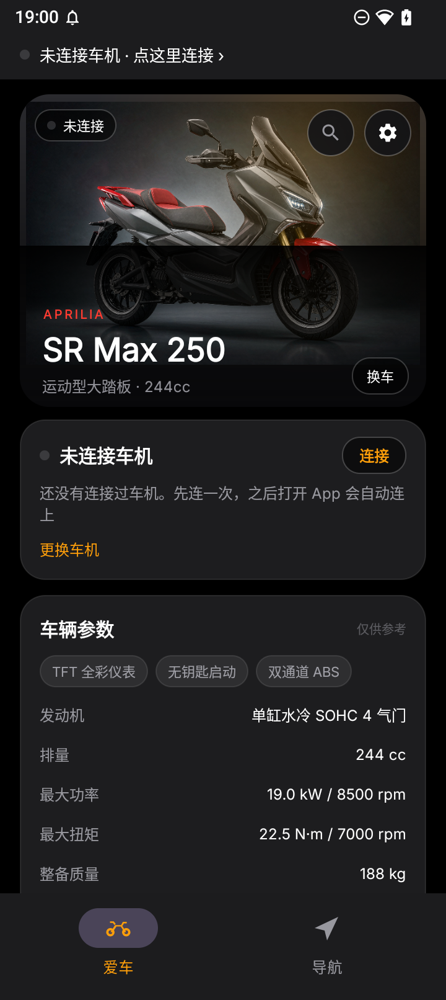
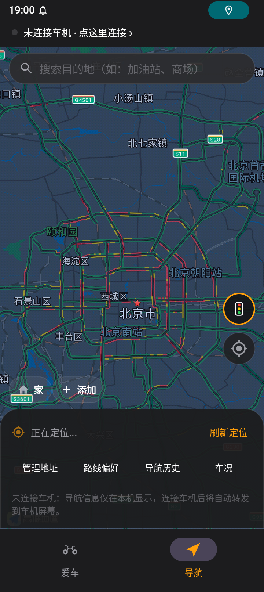
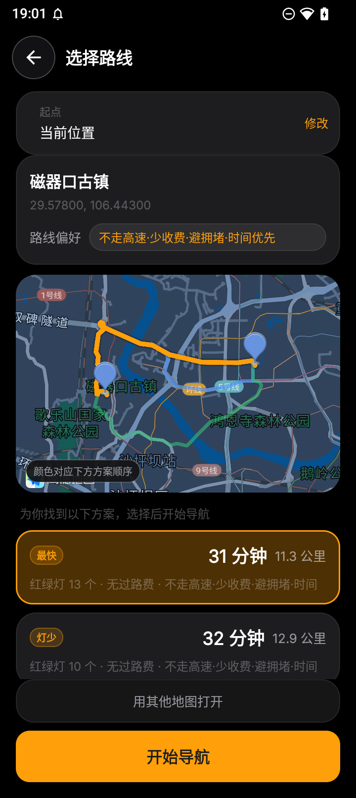
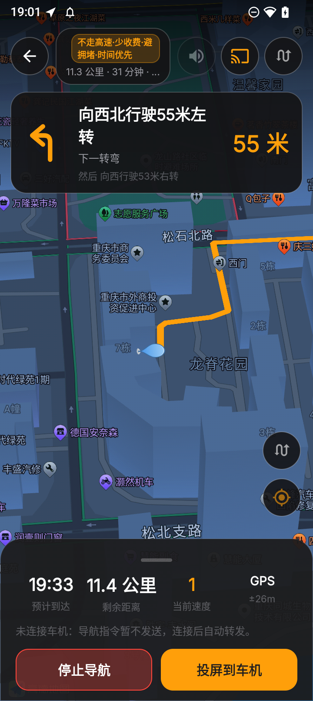
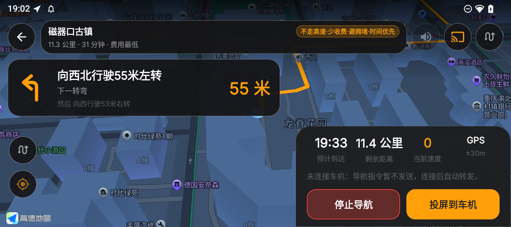
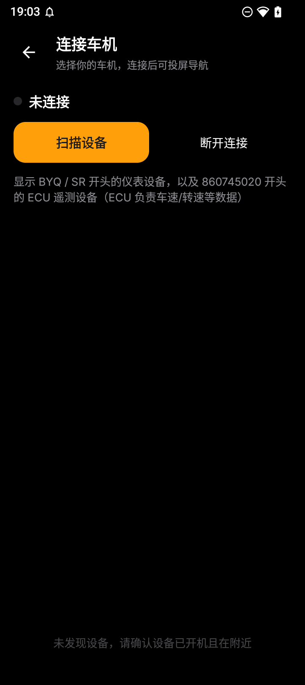

# MotoHUD Core · 把高德导航投到摩托车仪表盘

给**支持 BLE 互联的摩托车车机 / 仪表**用的 Android 应用（摩托车 HUD / 投屏导航）：
手机搜目的地、算路线、语音播报，**转向图标和剩余距离实时推到仪表屏上**，手机放进兜里也能导航。

[](https://github.com/mmaotv/motohud-core/releases/latest)
[](LICENSE)


**[⬇ 下载最新版](https://github.com/mmaotv/motohud-core/releases/latest)** ·
[更新日志](https://github.com/mmaotv/motohud-core/releases) ·
[反馈问题](https://github.com/mmaotv/motohud-core/issues)

> 个人独立开发，与任何整车厂商、车机厂商均无从属关系，也不含其任何代码、图片或资源。

---

## 它能做什么

- **投屏导航**：导航中把转向图标 + 剩余距离实时写入车机（支持 `REM/NEXT/NAVI` 与 `NA/RE/NE` 两种协议），到达发 `FINISH`、退出 `NO`；可开**息屏导航**，屏幕关了播报和投屏照常跑。
- **爱车页**：车型大图、实时连接状态、设备信息；内置 8 款比亚乔集团车型，连接后按蓝牙名自动匹配。
- **完整导航体验**：先选路线再导航、7 项路线偏好、偏航自动重算、更优路线提示、内置语音包播报、横竖屏自适应、日夜双主题、导航历史与轨迹。
- **掉线自动重连**：骑出范围再回来不用手动连。

底部只有 **爱车 / 导航** 两个页签，顶部常驻连接状态条。

> 为什么只有两个功能：实测原厂车机**只有投屏导航通道有数据交换**，仪表遥测 / 体检 / 故障码在 BLE 侧没有上行数据（原厂体检走的 HTTP 接口已失效）。空壳页面只会误导人，所以全功能旧版已归档到 [`motohud-bridge`](https://github.com/mmaotv/motohud-bridge)（分支 `archive/full-2.2.7`）。新功能只进本仓库。

---

## 下载安装

去 [Releases](https://github.com/mmaotv/motohud-core/releases/latest) 下载对应架构的 APK：

| 文件 | 适用 |
| --- | --- |
| `motohud-*-arm64.apk` | 近几年的手机（arm64-v8a），**优先选这个** |
| `motohud-*-armv7.apk` | 老设备 32 位（armeabi-v7a） |

安装时若提示「签名冲突」，先卸载旧版本再装（旧包用的调试签名）。

---

## ⚠️ 装完第一件事：填自己的高德 Key

**本应用不内置任何地图 Key。** 高德 Key 与「包名 + 签名 SHA1」绑定，别人给的 Key 一定用不了（会返回 `INVALID_USER_KEY 10001`），必须你自己申请一个，免费、几分钟搞定：

1. 打开 <https://lbs.amap.com> → 注册开发者 → 创建应用 → 添加 Key → **Android 平台**；
2. 包名填 `com.motohud.ble`，签名 SHA1 **应用内「设置 → 高德地图 Key」已经算好并支持一键复制**；
3. 在「服务管理」开通 **地图 SDK**、**搜索**、**定位** 三项；
4. 把 Key 粘回应用内输入框，保存即生效。

不填 Key 也能用：地图区隐藏、搜索不可用，但**蓝牙投屏链路仍可跑演示导航**，方便先验证车机能不能通。

---

## 截图

| 爱车 | 导航首页 | 路线选择 |
| --- | --- | --- |
|  |  |  |

| 引导（竖屏） | 引导（横屏） | 连接 / 扫描 |
| --- | --- | --- |
|  |  |  |

---

## 用起来

1. 摩托通电，车机进入可配对状态；
2. 「爱车 → 去连接」→ 扫描 → 点目标设备（掉线会自动回连）；
3. 「导航」页搜目的地（或点「家 / 公司」）→ 选路线 → 开始导航；
4. 引导页打开「投屏到车机」，转向与剩余距离即上屏，手机可息屏放兜里。

---

## 适用设备

- 具备 BLE 车机互联的摩托车，实测为**比亚乔（Piaggio）集团**系列随车 BLE 仪表；
- 按设备名 / MAC 前缀自动识别：`BYQ*`、`SR*`、`860745020*`；
- 其他品牌若协议相同，改 `ScanFragment` 的过滤规则即可适配（协议见下方折叠节）。

内置车型：**APRILIA** SR Max 250/300、GPR 150/250 ｜ **VESPA** Primavera 150、GTS 300 ｜ **PIAGGIO** Beverly 300、Medley 150。猜错车型可在「爱车 → 换车」手动改。

---

## 自己编译

```bash
# 需要 JDK 17、Python 3、Android SDK（compileSdk 36）

# ① 拉高德 SDK 并解出 so / assets（SDK 版权归高德，仓库不分发）
python tools/prepare_amap_sdk.py

# ② 编译
./gradlew assembleDebug
```

项目根目录先建 `local.properties`：

```properties
sdk.dir=/path/to/Android/Sdk
amap.apiKey=你的高德Key      # 可选，也可在应用内填
```

---

## 常见问题

| 现象 | 原因 / 处理 |
| --- | --- |
| 地图一片空白、搜索没结果 | 没填 Key，或 Key 的包名/SHA1 对不上。见上文，Key 必须自己申请 |
| 车机上没反应 | 先确认手机侧「投屏到车机」开着；再看是否已连上车机（顶部状态条是否变绿） |
| 图标方向不对 | 部分固件对图标编号的解释有差异，请反馈车机型号与固件版本 |
| 定位乱跳 | 已做多源融合与物理位移校验；室内 / 高楼区仍可能漂，属 GPS 本身限制 |
| 想省电 | 引导页可息屏导航，前台服务会保持投屏转发不断 |

---

## 协议要点

<details>
<summary>点开：投屏指令格式（便于适配其他车机）</summary>

下行帧：`[0..4) 命令 hex | [4..6) 数据长度 | [6..) 数据`，无效值一律 `fffe`。

上行文本指令（`:` → `0x1E`，首尾 `0x0D`）：

- SR 类：`REM :全程剩余::`、`NEXT :下一转弯::`、`NAVI :图标::`
- BYQ 类：`NA`、`RE`、`NE`
- 握手：`HELLO :A:<品牌>:`
- 到达：`FINISH :::`；退出：`NO`

转向图标沿用高德 `IconType` 数值（直行 9 / 左转 2 / 右转 3 / 左前 4 / 右前 5 / 掉头 8 / 到达 15），与主流导航软件的车机投屏数据一致。图标为本项目自绘矢量图（`res/drawable/ic_turn_*.xml`），不依赖第三方图标资源。

</details>

---

## 技术细节

<details>
<summary>点开：路线偏好 / 摩托车算路 / 偏航重算 / 更优换线</summary>

**高德没有免费的摩托车算路**：导航 SDK 的 `MOTOR_MULTIPLE_*` 是收费接口（要商务授权），免费搜索 SDK 的 `RouteSearch` 根本没有摩托车策略。所以本应用走「摩托车可达路网近似」——用驾车算路，把摩托最关心的约束做成可多选的偏好：

高德智能推荐（默认）/ 高速优先 / 不走高速 / 躲避拥堵 / 少收费 / 路况优先 / 时间优先。多选时按 `不走高速 > 少收费 > 躲避拥堵 > 高速优先 > 时间优先 > 路况优先` 合并成最接近的高德组合常量（高德策略是单个 int，不是位掩码）。

**偏航重算**：持续偏离路线 >90m 且定位精度可接受达数秒，即判定开错路，自动用当前位置重算并平滑接管。**更优换线**：每 4 分钟用当前位置重算对比，省时 ≥5 分钟或前方拥堵分段 ≥800m 且绕行更畅通时，顶栏提示「采用 / 忽略」。

国内禁摩/限行主要针对快速路、高架、隧道，勾「不走高速」能绕开大部分硬禁区。能否上路仍以当地法规与现场标志为准。

</details>

<details>
<summary>点开：定位为什么以前会漂（坐标系 / 缓存 / 抖动 / 吸附）</summary>

| 层 | 问题 | 处理 |
| --- | --- | --- |
| 坐标系 | 系统定位给 WGS84，地图路线是 GCJ02，国内恒定差 300~700m | 统一 `wgs84ToGCJ()` 纠偏后进引擎 |
| 定位源 | 系统 GPS 精度差、无速度航向 | 主用高德连续定位，系统定位 5s 无输出时兜底 |
| 缓存首帧 | 高德默认把上次结果当第一帧，人在重庆却先甩到北京 | 单次定位关缓存（`isLocationCacheEnable=false`），兜底也丢 90s 以上旧数据 |
| 错点 | 冷启动首帧常是基站定位，一帧甩到别的城市 | 按 216km/h 上限做物理不可能位移判定，连续 3 帧且精度 ≤20m 才重新定上位 |
| 抖动 | 静止来回跳、强平滑越拖越远 | 速度自适应指数平滑（静止 α=0.12，跳变 α=0.85） |
| 画法 | 算路把起点吸到路上，车标看着不在路上 | 按偏离距离分级吸附（<4m 不吸 / <15m 吸 0.5 / <60m 吸 0.75） |

</details>

<details>
<summary>点开：省流量 / 权限 / 目录结构</summary>

**省流量**：算路缓存 10 分钟、搜索与联想缓存 30 分钟；起点按 100m 网格取整；联想 450ms 防抖且最短 2 字；换线重算 4 分钟节流。

**权限**：蓝牙（连接车机）、定位（导航；Android 11 及以下扫描 BLE 也需要）、通知（前台服务与到达提醒）、唤醒锁（息屏导航）、安装未知应用（关于页下载新版后直接安装）。**车辆数据只在本机处理，不上传任何服务器。**

```
app/src/main/
├── assets/bikes/    车型插画（同名替换即生效）
├── java/com/motohud/ble/
│   ├── amap/     高德封装（Key 与隐私合规、POI、算路、缓存）
│   ├── ble/      GATT 连接、协议编解码、导航指令
│   ├── data/     Room、车型库、导航偏好与历史
│   ├── navi/     引导引擎、偏航检测、图标映射、坐标转换、投屏转发、语音包
│   ├── service/  息屏导航前台服务
│   └── ui/       爱车 / 导航 / 选路 / 引导 / 关于
└── tools/        高德 SDK 准备、车型图处理脚本
```

</details>

---

## 免责声明

个人自用工具，按「现状」提供，不对车辆、车机或人身安全作任何保证。**骑行中请勿操作手机**；投屏信息仅供参考，实际路况以现场为准。车机型号与固件差异可能导致部分指令无效，请先在静止状态下验证。车型参数来自公开资料，可能因年款 / 地区版本不同而有差异。

## 许可证

MIT，见 [LICENSE](LICENSE)。字体 Inter 依 SIL Open Font License 1.1 分发，见 [app/FONT-LICENSE-OFL.txt](app/FONT-LICENSE-OFL.txt)。
